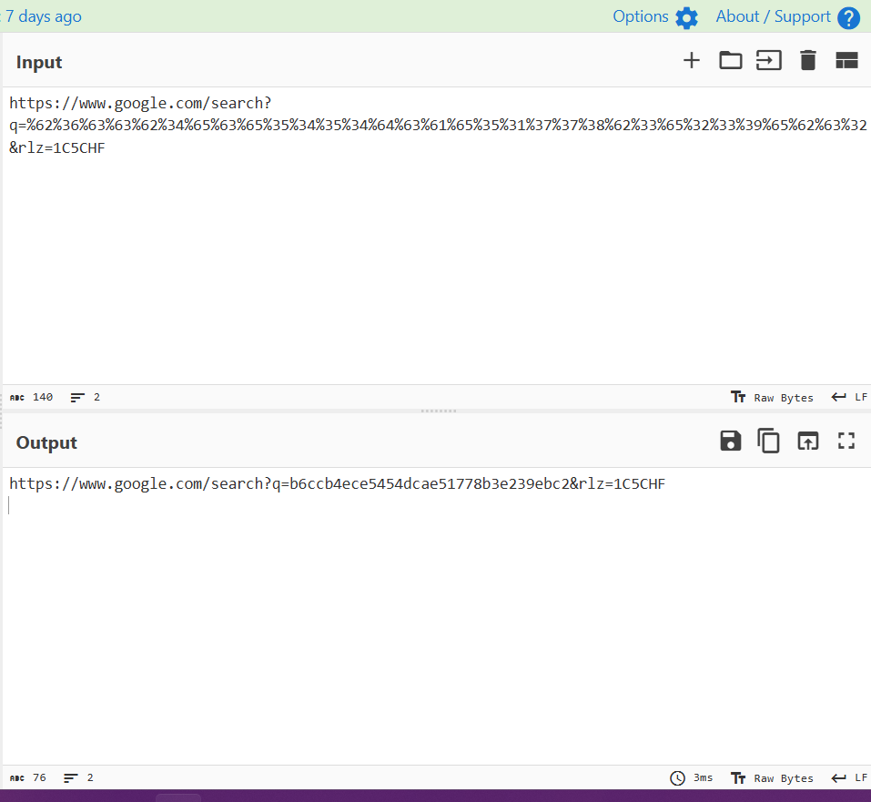
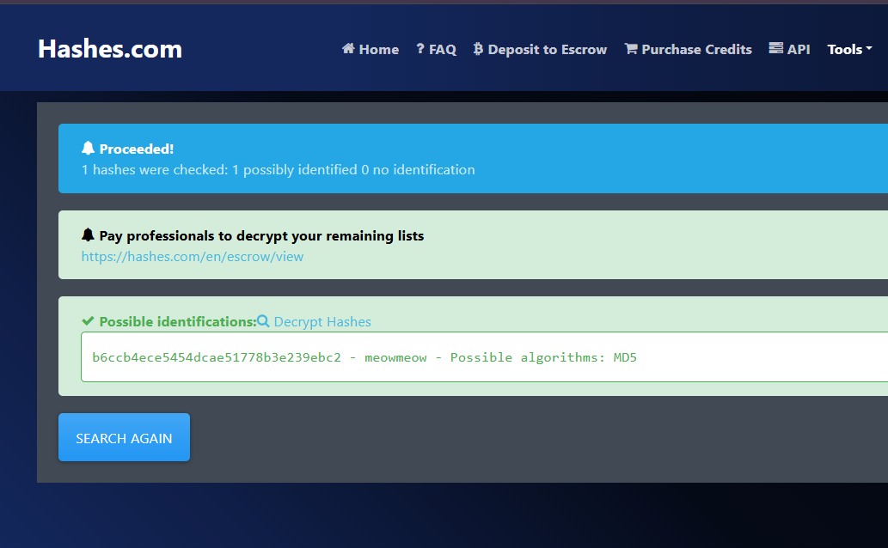

# Lab 4 Report

**Name:** Loun Rotha
**Group:** 01
**ID:** IDTB110272

## Lab #4: Mini-CTF (Cat Leak)

### 1. Objective

Investigate two URLs to determine how sensitive information was exposed and recover the original password from the leaked hash.

### 2. Investigation

#### Step 1: Analyze the First URL (Login Request)

Original URL:

```
https://securesystem.local:8890/login.php?userId=168&p1crypt=b6ccb4ece5454dca&p1crypt=e51778b3e239ebc2
```

Observations:

- `userId=168` identifies the user.
- The URL contains two `p1crypt` parameters.
- Each parameter contains 16 hexadecimal characters.

The two values are incomplete parts of the same hash. By combining them, we obtain:

```
First part:  b6ccb4ece5454dca
Second part: e51778b3e239ebc2

Combined hash:
b6ccb4ece5454dcae51778b3e239ebc2
```

#### Step 2: Analyze the Second URL (Google Search)

Original URL:

```
https://www.google.com/search?q=%62%36%63%63%62%34%65%63%65%35%34%35%34%64%63%61%65%35%31%37%37%38%62%33%65%32%33%39%65%62%63%32&rlz=1C5CHF
```

Observations:

- This URL is a Google search request.
- The `q` parameter contains percent-encoded data.
- The encoded data represents the hexadecimal hash from the first URL.

I used CyberChef's URL Decode operation to convert the percent-encoded characters into readable hexadecimal text.

Decoded result:

```
b6ccb4ece5454dcae51778b3e239ebc2
```

This also matches the combined hash obtained from the first URL.


#### Step 3: Identify the Hash and Recover the Original Password

I submitted the recovered hexadecimal string to an online hash identification tool.

Result:

| Field | Value |
|---|---|
| Hash | `b6ccb4ece5454dcae51778b3e239ebc2` |
| Plaintext | `meowmeow` |
| Possible algorithm | MD5 |

The hash was identified as a possible MD5 hash based on its format. The original password was successfully recovered.


### 3. Security Findings

1. Sensitive hash data was exposed through URL parameters.
2. The same hash was included in a Google search query.
3. The hash could be identified and its plaintext recovered.
4. The observed hash was MD5, contradicting the claim that bcrypt was used.

### 4. Recommendations

- Avoid placing sensitive information in URL parameters.
- Use HTTPS to protect information during transmission.
- Use secure password-hashing algorithms such as bcrypt or Argon2id.
- Use unique salts and appropriate work factors.

### 5. Conclusion

The investigation demonstrated how sensitive information can be exposed through URLs. By combining the two hash fragments from the login URL, decoding the Google search query, identifying the MD5 hash, and recovering its plaintext, I successfully discovered the original password.

### 6. Flag

```
cryptoCTF{meowmeow}
```
